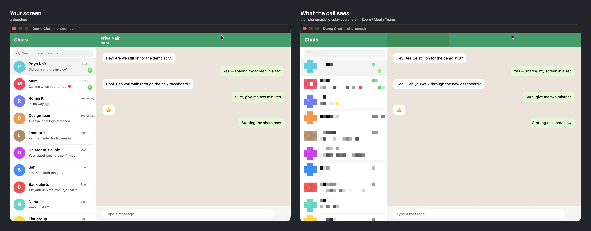

# sharemask

**Privacy for your Mac screen, in two halves.**

- **When you share your screen** in Zoom, Meet, Teams, Slack or FaceTime, the parts you choose (a
  WhatsApp chat list, a Slack sidebar, notification banners) are pixellated **only for the people
  watching**. Your own screen stays exactly as it is.
- **When someone uses your Mac**, the apps you lock stay hidden behind **Touch ID**.



- **Draw what to hide** right on top of any app: rectangles, squares, circles. Masks follow the window.
- **Panic key** (⌃⌥B) pixellates everything instantly; **hold ⌃⌥R** to reveal an app for a moment.
- **Present in a room** over HDMI or AirPlay with the same masks.
- Starts by itself when a call begins, and stays out of the way otherwise.

### App lock


- Locked apps stay hidden; opening one asks for **Touch ID** (or your Mac password).
- It asks again when you close and reopen the app, quit it, leave it idle, or lock the screen;
  minimizing doesn't relock.
- Optionally hides **notification previews** from locked apps ("WhatsApp — new notification").
- Quitting sharemask needs Touch ID too, and it comes back by itself if force-quit.
- ⌃⌘L locks the app in front, ⌃⇧⌘L locks everything. [More about App lock](docs/APP-LOCK.md)

## Install

Requires macOS 14 or later on Apple Silicon.

```sh
brew tap Larry8668/sharemask
brew trust Larry8668/sharemask     # Homebrew 7+: third-party taps must be trusted
brew install --cask sharemask
```

Or download the zip from the [releases page](https://github.com/Larry8668/share-mask/releases),
move `sharemask.app` to Applications and right-click → Open the first time (it's signed but not
notarised). To build it yourself, see [Building from source](docs/BUILDING.md).

## Getting started

1. **Open sharemask.** A short welcome asks for two permissions, Screen Recording (required) and
   Accessibility (recommended), with one click each.
2. **Choose what to hide**: in the sharemask window, Masks ▸ **Add an app**, draw boxes over the
   private parts, Save.
3. **Join a call.** sharemask asks to start; then, in your call app, share the screen called
   **sharemask**. Viewers see the masked version; you see everything.
4. **Lock apps** (optional): App lock ▸ **Add an app**. The next time someone opens it, it asks for
   Touch ID.

sharemask lives in the menu bar as a crossed eye (⊘). Open it from Finder or the Dock for the full
window; ⌃⌥K shows every key while you're sharing.

## Privacy at a glance

Everything happens on your Mac, and it's light: about 0.5% CPU while waiting for a call
([numbers](docs/PERFORMANCE.md)). Frames are never saved or sent anywhere; the only network request
is a daily check for a new version on GitHub (you can turn it off). Details:
[Privacy & data](docs/PRIVACY.md).

## Documentation

| | |
|---|---|
| [Using sharemask](docs/USING.md) | The app window, the menu, keys, drawing masks, meetings |
| [App lock](docs/APP-LOCK.md) | Locking apps with Touch ID, when it asks again, quit protection |
| [Presenting in a room](docs/PRESENTING.md) | TVs and projectors over HDMI / AirPlay, multiple monitors |
| [Configuration](docs/CONFIGURATION.md) | `presets.json`: masks, rules, allowlist, shortcuts |
| [Privacy & data](docs/PRIVACY.md) | What's stored, network use, logs |
| [Performance](docs/PERFORMANCE.md) | Battery and CPU use, and how idle cost went from 38% to 0.5% |
| [How it works](docs/HOW-IT-WORKS.md) | The proxy-display design, measured behaviour, performance |
| [Building from source](docs/BUILDING.md) · [Porting](docs/PORTING.md) · [Releasing](packaging/RELEASING.md) | For developers |

What's new: see the [releases](https://github.com/Larry8668/share-mask/releases).
