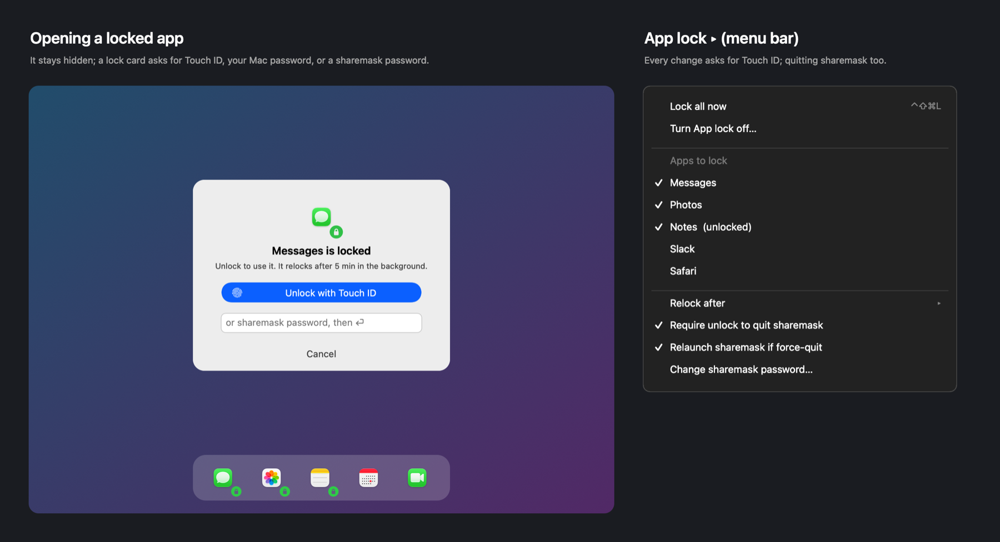

# App lock

Keep chosen apps hidden behind Touch ID on your own screen.

## How it works

Lock apps on your own screen, so someone using your unlocked Mac can't open them.

- **App lock ▸ Apps to lock**: tick apps. A locked app stays hidden; opening it (Dock, ⌘-Tab,
  Spotlight) shows a lock card and the **Touch ID prompt starts by itself**. Your **Mac login
  password** always works too (so you can't lock yourself out); an optional **sharemask password**
  can be typed on the card instead. Set, change or remove it under **Password** in the App lock card.
- **When it asks again** (relocks):

  | You… | Asks again? |
  |---|---|
  | open an app that wasn't running | yes |
  | close its window (red button), app stays in the Dock, then reopen | yes, instantly (or after 30 s / 1 min / 5 min / never — your choice) |
  | quit or force-quit it, then reopen | yes |
  | minimize it, then bring it back | no |
  | leave it in the background longer than *Relock after* | yes |
  | lock the screen / let the display sleep | yes (optional) |

- **Per-app settings**: click an app in the App lock card to set, for that app alone, when it locks
  again after its window closes (instantly, 30 s, 1 min, 5 min, never), after how long in the
  background, and whether its notification previews are hidden. **Lock now** and **Stop locking**
  are there too. *Defaults* (bottom of the card) is what newly added apps start with. Loosening any
  of these asks for Touch ID; tightening doesn't.
- **Editing masks of a locked app**: Edit regions on a locked app asks you to unlock it first, then
  opens the editor on its window.
- **Other desktops**: if you swipe to another desktop (or the app is full screen on its own
  desktop), the app isn't treated as closed; it relocks only when you actually close its window.
  The same goes for a second monitor: closing an app whose window is on it relocks as usual.
- **Notification previews** (off by default; App lock ▸ Options ▸ *Hide notification previews*):
  a banner from a locked app is covered on your screen by "WhatsApp — New notification — unlock to
  read". Clicking it opens the app, which then asks for Touch ID. sharemask reads banners through
  Accessibility, ten times a second while one is showing, so the very first frames of a banner
  sliding in may still be readable.
- **Shortcuts**: ⌃⌘L locks the app in front (adds it to the list if it isn't there yet), ⌃⇧⌘L
  locks every app. Both are remappable in Settings ▸ Shortcuts.
- **Require unlock to quit sharemask**: ⌘Q / Quit asks for Touch ID too. Shutdown, restart and
  logout are never blocked.
- **Relaunch if force-quit**: a per-user login agent (`~/Library/LaunchAgents/dev.sharemask.keepalive.plist`,
  no admin rights) brings sharemask back about a second after a Force Quit or `kill`, and it re-hides
  locked apps first. An authenticated Quit stays quit.
- **Apps that won't stay hidden** (Steam un-hides itself the moment it's hidden): sharemask notices
  and covers the app's windows with a lock panel instead of hiding it again and again.
- **Apps that restart themselves** right after you unlock them (Steam does after updating) stay
  unlocked if they're back within 10 seconds; a real quit still relocks.
- Changing any App lock setting (except making it stricter) asks for authentication.

### Where it's stored, and Keychain prompts

- The list of locked apps and their settings: `~/.config/sharemask/applock.json` (readable only by
  you). Someone using your unlocked Mac *could* edit it with Terminal, but they could just as well
  stop sharemask, so the Keychain added little here, and the list is always visible in the window.
- The sharemask password (as a salted PBKDF2 hash): your login keychain. sharemask reads it only when
  you type the password on a lock card. Because sharemask is self-signed, macOS treats every update
  as a new app and may ask you to allow access the first time after an update. Choose
  **Always Allow**. If you choose Deny, Touch ID and your Mac password still work; press ⏎ on the
  card to be asked again.
- Updating from 0.2.12 or earlier moves your settings out of the Keychain once (one last prompt).
  If that's denied, the App lock card says it's waiting, with **Try again**; nothing is lost.
- Locked apps are also masked whole-window in screen shares and presentations. Press ⌃⌥R to
  show one without the whole-window blur until the share ends (the regions you drew for it stay masked), or ⌃⌥⇧R to show
  it completely.

What it is and isn't: a guard against casual snooping on an unlocked Mac. Someone already logged in
as you and determined enough can still unload the agent, delete the app, or read an app's files
from disk; only your Mac's login lock is a real barrier. Uninstalling with Homebrew removes the
agent.

---
[← Back to the README](../README.md)
