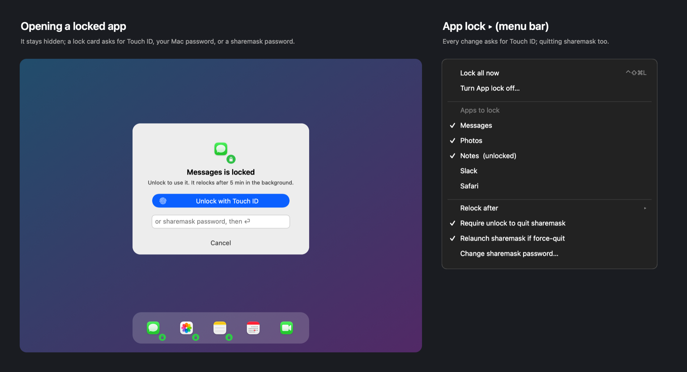

# App lock

Keep chosen apps hidden behind Touch ID on your own screen.

## How it works

Lock apps on your own screen, so someone using your unlocked Mac can't open them.

- **App lock ▸ Apps to lock**: tick apps. A locked app stays hidden; opening it (Dock, ⌘-Tab,
  Spotlight) shows a lock card and the **Touch ID prompt starts by itself**. Your **Mac login
  password** always works too (so you can't lock yourself out); an optional **sharemask password**
  can be typed on the card instead.
- **When it asks again** (relocks):

  | You… | Asks again? |
  |---|---|
  | open an app that wasn't running | yes |
  | close its window (red button), app stays in the Dock, then reopen | yes, instantly (or after 30 s / 1 min / 5 min / never — your choice) |
  | quit or force-quit it, then reopen | yes |
  | minimize it, then bring it back | no |
  | leave it in the background longer than *Relock after* | yes |
  | lock the screen / let the display sleep | yes (optional) |

- **Other desktops**: if you swipe to another desktop (or the app is full screen on its own
  desktop), the app isn't treated as closed; it relocks only when you actually close its window.
- **Notification previews** (off by default; App lock ▸ Options ▸ *Hide notification previews*):
  a banner from a locked app is covered on your screen by "WhatsApp — New notification — unlock to
  read". Clicking it opens the app, which then asks for Touch ID. sharemask reads banners through
  Accessibility, ten times a second while one is showing, so the very first frames of a banner
  sliding in may still be readable.
- **Shortcuts**: ⌃⌘L locks the app in front (adds it to the list if it isn't there yet), ⌃⇧⌘L
  locks every app. Both are remappable in Settings ▸ Shortcuts.
- **Require unlock to quit sharemask**: ⌘Q / Quit asks for Touch ID too. Shutdown, restart and
  logout are never blocked.
- **Relaunch if force-quit**: a per-user login agent (`~/Library/LaunchAgents/dev.sharemask.keepalive.plist`,
  no admin rights) brings sharemask back about a second after a Force Quit or `kill`, and it re-hides
  locked apps first. An authenticated Quit stays quit.
- Changing any App lock setting (except making it stricter) asks for authentication. Settings live
  in your Keychain, not in presets.json, so they can't be edited around.
- Locked apps are also masked whole-window in screen shares and presentations.

What it is and isn't: a guard against casual snooping on an unlocked Mac. Someone already logged in
as you and determined enough can still unload the agent, delete the app, or read an app's files
from disk; only your Mac's login lock is a real barrier. Uninstalling with Homebrew removes the
agent.

---
[← Back to the README](../README.md)
